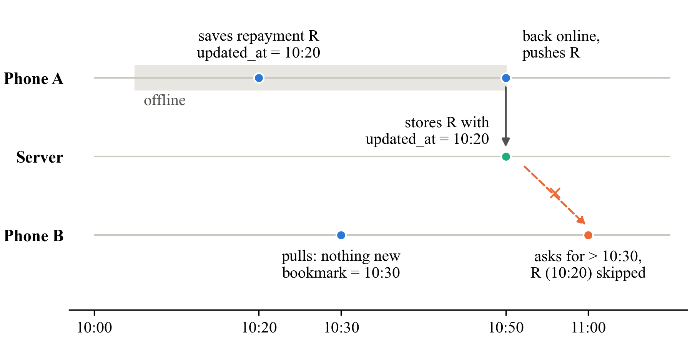
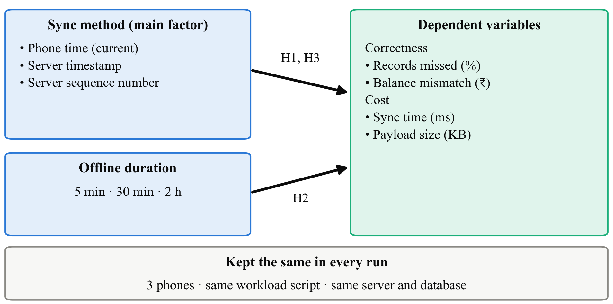
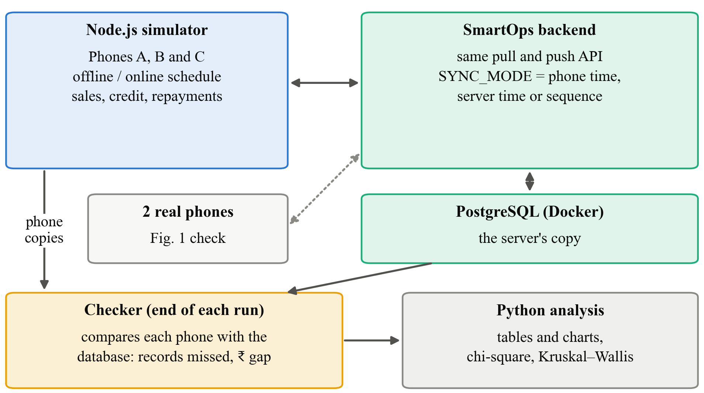
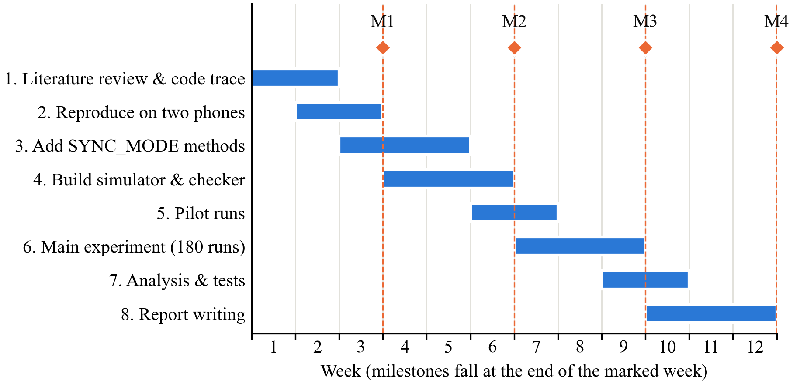

# Preventing Missing Records in Offline Khata Apps: A Study of Sync Methods in SmartOps

# Abstract

Many kirana shops still keep customer credit (khata) in a paper book. Apps that replace it have to keep working when the mobile network drops, so they save entries on the phone first and sync them with a server later. We built such an app, SmartOps. While reviewing its sync code we found a problem. Each record carries the time it was written on the phone, and other phones ask the server only for records newer than their last sync. A repayment saved offline and uploaded later can therefore be skipped by the shop's other phone for good, and the two phones then show different amounts owed by the same customer. This study measures how often that happens and compares three ways of marking records during sync: the phone's own time (the current method), a time stamped by the server, and a counter kept by the server. We will write a Node.js script that acts as three phones going offline and online against the real SmartOps backend. We will run 3 methods × 3 offline durations × 20 runs, and measure the percentage of records missed, the rupee difference in balances between phones, sync time and data size. The results will show which method SmartOps should use, and at what cost.

**Keywords:** offline-first apps, data synchronisation, timestamps, missed records, khata, kirana, simulation

# 1. Introduction

## 1.1 Title of the Research

**Preventing Missing Records in Offline Khata Apps: A Study of Sync Methods in SmartOps**

The problem is in the first half of the title: records that never reach some phones. What we compare is in the second half, namely the method used to track changes during sync. SmartOps is the app we test it on.

## 1.2 Background of the Study

A typical kirana shop gives credit to regular customers. The customer takes goods today and pays at the end of the week or month, and the shopkeeper notes it in a khata book. Digital tools help such shops. A study of 403 Indian unorganised retailers found that adopting digital payment tools raised revenue by 9.6% on average [1], and low-cost apps are seen as a way for kiranas to keep up with larger stores [2]. A digital khata, though, is only useful if the shopkeeper trusts it at least as much as the paper book.

Mobile internet in India is widespread but not always reliable, and many people covered by a network still face gaps in actual use [3]. A shop cannot stop billing because the signal dropped. So khata apps are usually built "offline-first". Every entry is saved on the phone straight away, and the phone exchanges changes with a server whenever the internet is available. The idea is old. The Coda file system let laptops keep working without the server and upload their changes later [4], and the Bayou system let mobile devices share data over weak connections [5]. It is now popular again under the name "local-first software" [6].

Offline-first apps need a sync step, and this step is easy to get wrong. Go et al. studied real Android apps and found several that lost or corrupted data during sync when the network failed [7].

SmartOps is the offline-first sales, stock and khata app we built for kirana shops. It is written in React Native with a WatermelonDB database on the phone. The backend is Node.js with PostgreSQL, running on AWS. Sync works in two steps:

- **Pull.** The phone asks the server for every record changed after its last sync time.
- **Push.** The phone uploads the records it created or changed since then.

The server replies to each pull with its current time, and the phone stores this as its "last pulled" time for the next pull.

The problem is in which time the server compares against. When the phone saves an entry, it writes its own clock time into the record's `updated_at` field. The server stores this value as it is, and the pull asks for rows where `updated_at` is later than the last pulled time. Figure 1 shows what goes wrong in a shop with two phones.

**Fig. 1.** Timeline of the missed-record problem: Phone A saves a repayment offline at 10:20 and uploads it at 10:50, but Phone B last pulled at 10:30 and only asks for records newer than that, so it never receives the 10:20 record

The repayment was written at 10:20 but reached the server at 10:50. Phone B had already synced at 10:30, so from then on it only asks for records newer than 10:30, and the repayment is never sent to it. Phone B keeps showing that Ramesh owes ₹500 more than he does. WatermelonDB's own documentation advises using the server's time for this purpose [8], but we could not find any measurement of how often the problem actually happens or how much it costs.

There is also a smaller issue. The phone keeps amounts as ordinary decimal numbers, while the server rounds them to two decimal places. An amount such as ₹99.999 therefore stays 99.999 on the phone and becomes 100.00 on the server. The difference is only a paisa, but it is still a mismatch.

## 1.3 Significance of the Study

**Academic value.** The study turns a known warning into measured numbers. It shows how often records are missed under each sync method, and how this changes with the time a phone spends offline.

**Technical value.** We will produce a reusable test script and two corrected versions of the SmartOps sync code. Other developers using the same pull/push pattern can apply the same test to their apps.

**Practical value.** For a shopkeeper, a missing repayment means an argument with a regular customer. A sync method that does not lose entries makes the digital khata something they can rely on.

**Beneficiaries.** Kirana owners and staff who use more than one phone; developers of offline-first apps for small businesses; and students and researchers who want a simple, repeatable way to test sync code.

**Contribution to knowledge.** The study gives a clear comparison of three change-tracking methods in a realistic app, with numbers for missed records, balance errors and cost.

**SDG alignment.** The work supports **SDG 8.3**, which promotes the growth of micro and small enterprises, and **SDG 9.c**, which is about access to information and communication technology. Reliable offline apps make digital record-keeping usable on the networks small shops actually have.

## 1.4 Aim, Objectives, Research Questions and Hypotheses

**Aim.** To find out which sync method stops offline khata records from being missed by other phones in the same shop, and what it costs in time and data.

**Objectives.**

- **O1.** To confirm the missed-record problem in SmartOps by tracing the code and reproducing it with two phones.
- **O2.** To build a Node.js script that simulates three phones against the real SmartOps backend, and to add two alternative sync methods (server timestamp and server sequence number) that can be switched on for testing.
- **O3.** To run 180 simulated runs (3 methods × 3 offline durations × 20 runs), recording the percentage of records missed, the rupee difference in balances, sync time and data size.
- **O4.** To compare the three methods using tables, charts and two simple statistical tests, and to recommend one for SmartOps.

**Research questions.**

- **RQ1.** Does the sync method change the percentage of records that other phones miss?
- **RQ2.** With the current method, do longer offline periods lead to more missed records?
- **RQ3.** Do the two alternative methods make sync slower or larger?

**Hypotheses.**

- **H1.** The percentage of missed records differs between the three methods. We expect the current method to miss records, and the two server-based methods to miss almost none. (*Null: the percentage missed is the same for all three methods.*)
- **H2.** With the current method, longer offline periods lead to a higher percentage of missed records. (*Null: offline duration makes no difference.*)
- **H3.** The two alternative methods do not make sync noticeably slower. We treat a difference of under 10% in median sync time as not noticeable. (*Null: sync time is the same for all three methods.*)

# 2. Literature and Research Foundation

## 2.1 Literature Review

**Working offline and syncing later.** Kistler and Satyanarayanan's Coda file system was one of the first to let a client keep working while disconnected from the server and upload its changes on reconnection. They found this workable in practice, though conflicts had to be handled when two people changed the same file [4]. Terry et al.'s Bayou system went further for mobile devices: each device kept a log of its writes, and devices exchanged these logs to reach the same state over time [5]. Both were built for laptops in the 1990s and did not measure missed updates.

**Local-first software.** Kleppmann et al. describe apps that keep the main copy of the data on the user's device, work offline, and sync across devices when possible [6]. Their essay sets out goals and describes prototypes, but it does not test the simpler timestamp-based sync used by most mobile apps.

**Time and ordering.** Lamport showed that clocks on different machines cannot be trusted to decide which event happened first, because they drift and can be set wrongly [9]. This is the root of our problem. The phone's clock records when an entry was *written*, not when the server *received* it, and other phones only care about the second.

**Sync failures in real apps.** Go et al. tested how popular Android apps handle sync and found cases of lost updates and inconsistent data when the network or the app failed. They proposed a sync service called Simba [7]. Their study is the closest to ours, but it looked at native Android apps in 2015 and did not focus on the timestamp used for pulling changes.

**Framework guidance.** The WatermelonDB documentation, which SmartOps follows, says the server should record its own time for each change and should guard against clock problems [8]. It gives the advice but no data on how much damage the simpler approach causes.

**Table 1.** Summary of key prior studies

| Study | What it looked at | Method | Main finding | Gap for us |
|---|---|---|---|---|
| Kistler & Satyanarayanan [4] | Working offline with a file server | Built and used a system | Offline work and later upload are practical | No measurement of missed updates |
| Terry et al. [5] | Syncing mobile devices | System design | Devices reach the same state by exchanging logs | Not tested on modern phone apps |
| Kleppmann et al. [6] | Local-first apps | Essay and prototypes | Apps can work offline and sync later | No test of timestamp-based sync |
| Lamport [9] | Clocks and event order | Theory | Machine clocks cannot order events reliably | No app-level study |
| Go et al. [7] | Sync in Android apps | Testing real apps | Apps lose data during sync | Did not isolate the sync timestamp |
| WatermelonDB docs [8] | Sync backend design | Developer guide | Use server time for changes | Advice only, no measurement |

## 2.2 Theories, Concepts and Existing Methodologies

**Offline-first sync.** The phone is allowed to work alone and catch up later. The price is that the phone and the server can disagree until the next successful sync.

**Pull cursor.** This is the "bookmark" a phone sends when it pulls: "give me everything after this point". The pull is correct only if every change that arrives at the server later gets a *later* bookmark value than anything already handed out. The three methods we compare are three ways of choosing this bookmark.

**Client time versus server time.** Following Lamport [9], a phone's clock tells when something was written on that phone. It does not tell when the server learned about it. The pull, however, depends on when the server learned about it.

**Sequence number.** The server keeps a counter that goes up by one for every record it stores, like a token number at a bank counter. The counter never goes backwards and two records never get the same number, so "everything after token 250" is always well defined [10].

**Existing methods for studying sync.** Researchers have used three kinds of method. System builders test their design with benchmarks [5], [4]. Some studies test real apps under failures [7]. Others rely on reasoning about clocks [9]. A small, controlled simulation suits a student project. It is cheap, it can be repeated as many times as we like, and it runs against the real server code. Its weakness is that simulated phones are simpler than real phones, which we partly address with a short check on real devices.

**Table 2.** Variables in this study

| Variable | Type | How we measure it |
|---|---|---|
| Sync method | Independent | 3 levels: phone time (current), server timestamp, server sequence number |
| Offline duration | Independent (second factor) | 3 levels: 5 min, 30 min, 2 h of shop time |
| Records missed (%) | Dependent | Records on the server but missing from at least one phone, divided by all records |
| Balance mismatch (₹) | Dependent | Sum over customers of the difference between each phone's balance and the server's |
| Sync time (ms) | Dependent | Time for one pull plus push |
| Payload size (KB) | Dependent | Data sent and received per sync |
| Number of phones, workload, server setup | Controlled | Fixed at 3 phones, same workload script, same server |

## 2.3 Research Gap

Previous work tells us that phone clocks are unreliable [9], that apps can lose data during sync [7], and that a server-side time is recommended [8]. Three things are missing:

1. **No numbers.** We found no study that measures how many records the phone-time method misses, or how this grows with time spent offline.
2. **No money view.** Earlier studies talk about "inconsistent data". For a khata app the useful question is how many rupees the balances are off by, and nobody has reported that.
3. **No side-by-side cost comparison.** The recommended fixes are rarely tested against the current method for their effect on sync time and data size.

We address these gaps by running all three methods on the same app, the same workload and the same simulated phones, and reporting missed records, rupee differences and cost together.

## 2.4 Research Framework / Conceptual Framework

Figure 2 shows our framework. The sync method is the main independent variable. Offline duration is the second factor, because the longer a phone is offline, the more likely another phone syncs in between. The dependent variables fall into two groups: correctness (records missed, balance mismatch) and cost (sync time, payload size). The number of phones, the workload and the server setup are kept the same in every run.

**Fig. 2.** Conceptual framework: sync method and offline duration are the independent variables; records missed, balance mismatch, sync time and payload size are the dependent variables; phones, workload and server are held constant

The link from sync method to records missed comes from the clock argument in Section 2.2. The link from offline duration comes from the timeline in Figure 1, where a longer gap means more chances for Phone B to sync in the middle. The link to cost comes from the fact that the new methods add a small amount of work on the server.

# 3. Research Problem and Design

## 3.1 Research Problem

SmartOps, like many offline-first apps, uses the time on the phone to decide which records other phones should receive. A record written offline and uploaded later can be skipped by another phone permanently, and the shop then sees two different balances for the same customer. We do not know how often this happens in normal use, how much money it affects, or whether the recommended fixes slow the app down.

**Problem statement.** *It is not known how much the choice of sync method (phone time, server timestamp or server sequence number) affects the number of khata records missed by other phones, and the resulting balance errors, in an offline-first app used under intermittent connectivity.*

## 3.2 Research Approach

We use a **quantitative** approach. Everything we want to know is a count or a measurement: records missed, rupees, milliseconds and kilobytes. Our hypotheses can be checked with numbers, and user opinions would not change whether a record reached a phone or not.

## 3.3 Research Design

We use an **experimental design based on simulation**, with a small development part.

- **Development.** We add a switch (`SYNC_MODE`) to the SmartOps backend. The switch selects one of three methods. For the *phone time* method, the code is unchanged. For the *server timestamp* method, the server ignores the phone's `updated_at` and writes its own time when it receives the push. For the *server sequence number* method, the server gives every stored record the next number from a counter, and the pull asks for numbers greater than the last one the phone saw.
- **Simulation experiment.** A Node.js script acts as three phones of one shop. Each simulated phone keeps its own copy of the records, creates sales, credit sales and repayments, goes offline and online on a schedule, and syncs using the same pull and push requests as the real app. To keep runs short, we compress time so that one real second stands for one minute in the shop. This does not affect the result, because the problem depends only on the order of events, not on how long they take.
- **Check on real phones.** We reproduce the Figure 1 scenario once for each method using two Android phones running SmartOps. This confirms that the script behaves like the real app.

We chose simulation over a field study because a field study cannot control when phones go offline, would take months to collect enough cases, and would put real shops' money records at risk.

**Table 3.** Experimental design

| Factor | Levels | Values |
|---|---|---|
| Sync method | 3 | Phone time (current); server timestamp; server sequence number |
| Offline duration | 3 | 5 min; 30 min; 2 h (shop time) |
| Runs per combination | 20 | Different random schedules |
| **Total runs** | **180** | Each run covers 4 hours of shop time with 3 phones |

## 3.4 Scope of the Research

- **Research area.** Data sync in offline-first mobile apps.
- **Population.** Pull/push sync of the kind used by SmartOps and other apps built on WatermelonDB. The unit we study is one shop with three phones over four hours of trading.
- **Variables.** As listed in Table 2.
- **Conditions.** One server; all phone clocks correct; phones go offline for 5 minutes to 2 hours at a time.
- **Applications.** SmartOps and similar khata, billing and field-data apps that sync by timestamps.
- **Exclusions.** We do not study:
  - phones whose clocks are set wrong (listed as future work);
  - two phones editing the same record at once;
  - what happens when one bad record blocks a whole push (future work);
  - security, battery use, or credit scoring.

# 4. Research Implementation and Evaluation

## 4.1 Data Collection

**Primary data.** All data comes from our own experiment runs. For every sync, the script logs the method, the phone, the start and end time, the bytes sent and received, and the number of records. At the end of each run, the script reads every record from PostgreSQL and from each simulated phone and writes a summary row: records on the server, records missing on each phone, and each phone's balance per customer. With about 150 to 250 records created per run, we expect roughly 10,000 records per method across 60 runs.

**Secondary data.** The SmartOps demo data (products, customers and past sales) gives us realistic shop behaviour for the script: how many items per sale, how often a sale is on credit, and typical amounts. A few repayment amounts with three decimal places (for example ₹99.999) are included on purpose so that the rounding issue can be seen.

**Sample size.** Twenty runs per combination gives 60 runs per method. Our main test (H1) compares record counts, not runs, so it works with thousands of records per method and can pick up even a small difference in the miss rate. For the tests that compare runs (H2, H3), the Kruskal–Wallis test is usually considered reliable with at least five values per group, so 20 per group is comfortably enough. We will add more runs if a result is borderline.

## 4.2 Tools and Techniques

**Table 4.** Tools and techniques

| Category | Tool | Why we use it |
|---|---|---|
| Server | SmartOps backend (Node.js, Express) with a `SYNC_MODE` switch | Tests the real sync code |
| Database | PostgreSQL in Docker on a laptop | Same database as production, but isolated from real shop data |
| Simulator | Our own Node.js script | Acts as three phones and logs every sync |
| Real-phone check | Two Android phones with SmartOps | Confirms the script matches the app |
| Analysis | Python with pandas, matplotlib and SciPy | Tables, charts, chi-square and Kruskal–Wallis tests |
| Hardware | Our laptops; our own phones | Enough for 180 short runs |

The code changes for the two new methods are small. For the server timestamp method, the push handler sets `updated_at` to the server's clock instead of the value sent by the phone. For the sequence number method, we add a `server_seq` column filled from a PostgreSQL counter on every insert or update. The pull then filters on `server_seq` and returns the highest number it sent as the phone's next bookmark. Figure 3 shows how the parts fit together.

**Fig. 3.** Test setup: the Node.js simulator acts as three phones and syncs with the SmartOps backend and PostgreSQL; after each run a checker compares every phone with the database and the results go to Python for charts and tests

## 4.3 Data Analysis and Performance Measures

**Measures.**

- **Records missed (%)** = records on the server that are missing from at least one phone ÷ all records on the server × 100, taken after every phone has synced twice at the end of the run.
- **Balance mismatch (₹)** = for each customer, the difference between a phone's balance and the server's balance, added up over all customers and phones. We report the part caused by missing records and the part caused by rounding separately.
- **Sync time (ms)** = time for one pull plus push, reported as the median per run.
- **Payload size (KB)** = bytes sent plus received per sync, reported as the median per run.

**Descriptive analysis.** For each method and offline duration we will report the mean and median of each measure in a table. We will also draw a bar chart of records missed and a box plot of sync time.

**Statistical tests.** We use two simple tests at a 5% significance level.

- **H1, chi-square test.** We make a table with one row per method and two columns: records delivered to all phones and records missed. The chi-square test checks whether the proportion missed differs between methods more than chance would explain.
- **H2 and H3, Kruskal–Wallis test.** This test compares three groups of runs without assuming the numbers follow a bell curve. That suits our data, because many runs of the fixed methods will show zero misses. For H2, the groups are the three offline durations under the current method, and the value is records missed per run. For H3, the groups are the three methods, and the value is median sync time per run.

**Comparisons.** Each new method is compared with the current method. The script's results for the Figure 1 scenario are also compared with the same scenario run on two real phones.

## 4.4 Expected Outcomes

The following are what we expect to see, based on the code and on how clocks behave. They are not results.

- The current method will miss records in every offline duration, and more of them when phones stay offline longer.
- The server timestamp method will miss very few or none. A rare miss may still happen when a push and a pull reach the server at almost the same moment, and we will count these cases.
- The sequence number method should behave at least as well as the server timestamp, because two records can never get the same number.
- Balance mismatch will come mostly from missed records and will be in whole rupees. Under the current method, a much smaller part at paisa level will come from rounding. The lasting fix for that is to store amounts in paise as whole numbers.
- With the two server methods, each phone downloads its own records once more after pushing them, because the server gives them a newer mark. This should remove the rounding gap as well, at the cost of slightly more data per sync. Apart from this, we expect very little change in sync time.
- **Final output:** a recommended sync method for SmartOps, the modified backend code, and the test script, which others can reuse.

# 5. Research Management and Output

## 5.1 Limitations

- **Technical.** The simulated phones are simpler than the real WatermelonDB app. We check the main scenario on real phones, but not every run.
- **Data.** The workload is generated from demo data, not recorded from a real shop.
- **Resource.** We run everything on one laptop, so sync times are for a local server and will be lower than over mobile data.
- **Time.** Compressing time (one second for one minute) keeps runs short, but it means we do not test effects that build up over days.
- **Financial.** We cannot afford to deploy to real shops for a field trial.
- **Methodological.** We assume all phone clocks are correct. Wrong clocks would probably make the current method worse, so our numbers may understate the problem. Two other known issues are left for future work: a single bad record blocking a whole push, and pushes too large for the server to accept.

## 5.2 Research Work Plan and Gantt Chart

The plan runs for 12 weeks from approval.

**Table 5.** Work plan, milestones and deliverables

| # | Activity | Weeks | Deliverable |
|---|---|---|---|
| 1 | Literature review and code tracing | 1–2 | Review notes; confirmed bug trace |
| 2 | Reproduce the problem on two phones | 2–3 | Screenshots and logs of the missed record |
| 3 | Add `SYNC_MODE` with the two new methods | 3–5 | Modified backend code |
| 4 | Build the three-phone simulator and checker | 4–6 | Working test script |
| 5 | Pilot runs and fixes | 6–7 | Checked script |
| 6 | Main experiment (180 runs) | 7–9 | Results files |
| 7 | Analysis, charts and tests | 9–10 | Tables and charts |
| 8 | Report writing and review | 10–12 | Final report |

**Milestones:** M1 (week 3): problem reproduced on real phones; M2 (week 6): simulator ready; M3 (week 9): all runs complete; M4 (week 12): final report submitted.

**Fig. 4.** Gantt chart of the 12-week work plan with milestones M1–M4

## 5.3 Cost Estimation / Budget

The study needs almost no money, because all the software is free and we already own the laptops and phones.

**Table 6.** Estimated budget

| Head | Item | Amount (₹) |
|---|---|---|
| Equipment | Our own laptops and two Android phones | 0 |
| Software | Node.js, PostgreSQL, Docker, Python (all free) | 0 |
| Cloud | Not needed; the experiment runs locally | 0 |
| Data collection | Mobile data for the real-phone check | 300 |
| Materials | Printing and binding of the report | 800 |
| Travel | Meetings with guide | 500 |
| Testing | Runs on our laptops | 0 |
| Publication | Not planned for this course | 0 |
| Miscellaneous | Contingency | 400 |
| **Total** | | **2,000** |

## 5.4 Expected Contribution, Ethical Considerations and References

**Expected contribution.**

- *Knowledge:* measured numbers on how often the phone-time method misses records and how much money that affects.
- *Technical:* two corrected sync methods for SmartOps and a test script that can be reused.
- *Practical:* a khata app in which every phone in the shop shows the same balance for each customer.
- *Methodological:* a simple, repeatable way to test sync code without real users.

**Ethical considerations.**

- *Approval.* No people take part in this study and no personal data is collected. We will still inform our guide and follow the department's rules for student projects.
- *Consent.* Not needed, because there are no participants.
- *Privacy.* All customer names and amounts are made up. The live SmartOps server and real shop data are not used for the experiment. Since no real personal data is processed, the duties of India's Digital Personal Data Protection Act, 2023 [11] do not arise, but we follow its idea of collecting only what is needed.
- *Data security.* Code and results are kept in our private repository.
- *Plagiarism.* All sources are cited in IEEE style, and the report will be checked with the institution's plagiarism software.

# References

[1] A. Adhikary, K. S. Diatha, S. B. Borah, and A. Sharma, "How does the adoption of digital payment technologies influence unorganized retailers' performance? An investigation in an emerging market," *J. Acad. Marketing Sci.*, vol. 49, no. 5, pp. 882–902, 2021, doi: 10.1007/s11747-021-00778-y.

[2] V. Choudhary and R. K. Aithal, "Low-cost technologies for kirana (small) retail: A game changer?," *IIM Kozhikode Society & Management Review*, vol. 12, no. 2, pp. 250–258, 2023, doi: 10.1177/22779752221099128.

[3] GSMA, "The state of mobile internet connectivity report 2023," GSMA, London, U.K., Oct. 2023. [Online]. Available: https://www.gsma.com/r/wp-content/uploads/2023/10/The-State-of-Mobile-Internet-Connectivity-Report-2023.pdf

[4] J. J. Kistler and M. Satyanarayanan, "Disconnected operation in the Coda file system," *ACM Trans. Comput. Syst.*, vol. 10, no. 1, pp. 3–25, 1992.

[5] D. B. Terry, M. M. Theimer, K. Petersen, A. J. Demers, M. J. Spreitzer, and C. H. Hauser, "Managing update conflicts in Bayou, a weakly connected replicated storage system," in *Proc. 15th ACM Symp. Operating Systems Principles (SOSP)*, Copper Mountain, CO, USA, 1995, pp. 172–182, doi: 10.1145/224056.224070.

[6] M. Kleppmann, A. Wiggins, P. van Hardenberg, and M. McGranaghan, "Local-first software: You own your data, in spite of the cloud," in *Proc. ACM SIGPLAN Int. Symp. New Ideas, New Paradigms, and Reflections on Programming and Software (Onward!)*, Athens, Greece, 2019, pp. 154–178, doi: 10.1145/3359591.3359737.

[7] Y. Go, N. Agrawal, A. Aranya, and C. Ungureanu, "Reliable, consistent, and efficient data sync for mobile apps," in *Proc. 13th USENIX Conf. File and Storage Technologies (FAST)*, Santa Clara, CA, USA, 2015, pp. 359–372.

[8] Nozbe, "Sync — Backend implementation," *WatermelonDB Documentation*. [Online]. Available: https://watermelondb.dev/docs/Sync/Backend (accessed Sep. 21, 2026).

[9] L. Lamport, "Time, clocks, and the ordering of events in a distributed system," *Commun. ACM*, vol. 21, no. 7, pp. 558–565, 1978, doi: 10.1145/359545.359563.

[10] M. Kleppmann, *Designing Data-Intensive Applications*. Sebastopol, CA, USA: O'Reilly Media, 2017.

[11] *The Digital Personal Data Protection Act, 2023* (Act No. 22 of 2023), Gazette of India, Ministry of Law and Justice, Government of India, Aug. 11, 2023.
