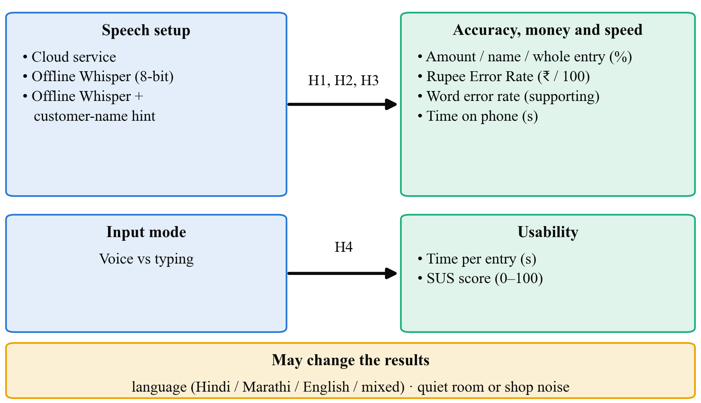
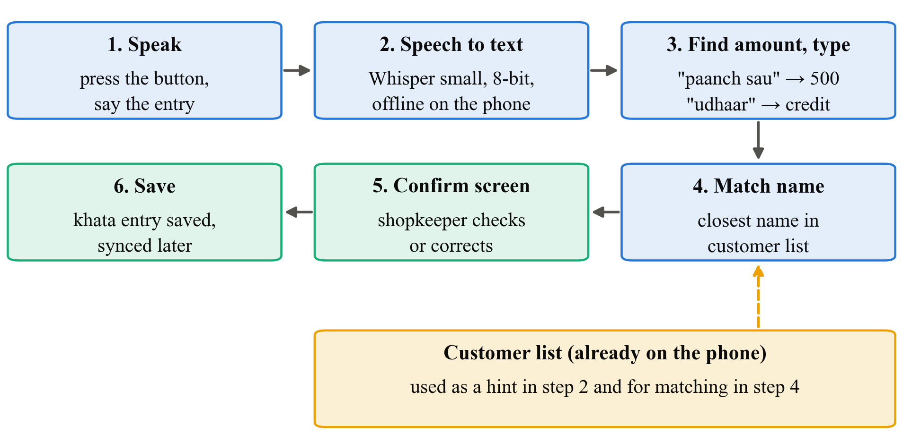
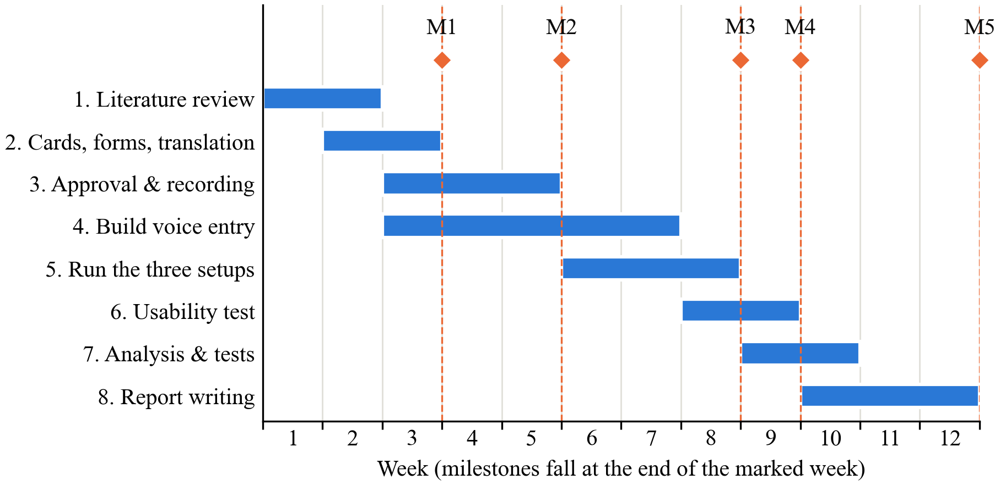

# Offline Voice-Based Khata Entry in Hindi, Marathi and English for Kirana Stores

# Abstract

Kirana shopkeepers often write credit (khata) entries while serving a queue, and typing names and amounts on a phone is slow at that moment. Saying the entry aloud ("Ramesh ko 500 udhaar") would be quicker, but most speech recognition runs in the cloud and needs internet, which a shop does not always have. Shopkeepers also mix Hindi, Marathi and English in one sentence. This study checks whether a speech model running fully offline on a cheap Android phone can pick out the three things a khata entry needs: the customer's name, the amount, and whether it is credit or a repayment. We will record about 360 short commands from 12 speakers (ourselves, friends and a few shopkeepers). We will then compare a cloud speech service with an offline, compressed Whisper model on the phone, with and without a list of the shop's customer names to help it. We measure how often the amount, the name and the whole entry come out right, and how long the phone takes. A small test with 8 to 10 people will compare voice entry with typing on time taken and a standard usability questionnaire. The study is built on our app SmartOps.

**Keywords:** speech recognition, offline, Whisper, Hindi, Marathi, code-mixing, khata, kirana, usability

# 1. Introduction

## 1.1 Title of the Research

**Offline Voice-Based Khata Entry in Hindi, Marathi and English for Kirana Stores**

The title covers what we test (entering khata by voice), the condition that matters most (offline, on the phone), the languages (Hindi, Marathi, English and mixes of them) and the users (kirana shopkeepers).

## 1.2 Background of the Study

In a kirana shop, regular customers often take goods on credit and pay later. The shopkeeper records this in a khata book. Digital tools are known to help small retailers. For example, a study of 403 Indian unorganised retailers found that adopting digital payment tools raised revenue by 9.6% on average [1], and low-cost technology is seen as important for kiranas [2]. Khata apps exist, yet many shopkeepers still keep the paper book too.

One reason is the effort of typing. A credit entry means finding the customer, typing the amount and choosing credit or repayment, all while other customers wait. Typing is also harder for people who are not comfortable reading and writing on a phone. Research on low-literacy users in India found that interfaces built on voice and pictures instead of text were strongly preferred [3]. A seven-month study of a voice-based service for farmers in Gujarat found that users preferred speaking to typing [4].

Speech recognition has improved a lot. OpenAI's Whisper model was trained on 680,000 hours of audio in many languages and works reasonably well on new languages without extra training [5]. AI4Bharat built IndicWhisper for Indian languages and showed that its error rate changes a lot from one type of speech to another [6]. Large Indian speech datasets like IndicVoices now exist [7]. For a kirana app, though, three problems remain:

1. **No internet.** The best speech services run in the cloud, and shops lose connectivity often [8]. Smaller versions of Whisper can run on a device [9], but most results are reported for English on laptops, not for Hindi or Marathi on cheap phones.
2. **Mixed languages.** A shopkeeper might say "Ramesh ka 250 ka udhaar add karo", mixing Hindi and English in one sentence. Speech systems find such mixed speech hard [10].
3. **Small details matter.** For a khata entry, the exact words matter less than getting three details right: name, amount and type. If "dhai sau" (250) is heard as "do sau" (200), the customer's account is off by ₹50. A dataset called SLURP showed that checking these extracted details tells you more than counting word errors [11].

SmartOps is the offline-first sales and khata app we built. It already stores the shop's customers on the phone, so a voice feature can use that customer list to help the speech model recognise names.

## 1.3 Significance of the Study

**Academic value.** We give results for a task that current research does not cover: short, mixed-language khata commands, judged by whether the name, amount and type are right.

**Technical value.** We show whether an offline speech model is practical on a cheap phone, with real numbers for accuracy and time, and we test a simple trick (giving the model the customer list) that could improve name accuracy.

**Practical value.** If voice entry works offline, shopkeepers can record credit faster, including those who find typing hard.

**Beneficiaries.** Kirana owners and staff; developers of apps for small shops; and students working on Indian-language speech apps.

**Contribution to knowledge.** A small, honest comparison of cloud and offline speech recognition for khata entries, and a first look at whether real users find voice entry faster than typing.

**SDG alignment.** The study supports **SDG 8.3** (support for small enterprises), **SDG 9.c** (access to ICT) and **SDG 10.2** (inclusion of all, including people less comfortable with reading and typing).

## 1.4 Aim, Objectives, Research Questions and Hypotheses

**Aim.** To find out whether an offline speech model on a cheap Android phone can correctly capture khata entries spoken in Hindi, Marathi, English or a mix, and whether voice entry is faster than typing.

**Objectives.**

- **O1.** To record about 360 short khata commands from 12 speakers, where the correct name, amount and type of each command are known in advance.
- **O2.** To add an offline voice-entry option to SmartOps, using a compressed Whisper model on the phone and simple rules to pick out the name, amount and type.
- **O3.** To compare a cloud speech service with the offline model, with and without the customer-name list, on how often the amount, the name and the whole entry are right, and on time taken.
- **O4.** To compare voice entry with typing in a small test with 8 to 10 people, on time taken and usability score.

**Research questions.**

- **RQ1.** How often does the offline model get the whole entry right, compared with the cloud service?
- **RQ2.** Does giving the model the shop's customer list improve name accuracy?
- **RQ3.** Is entering khata by voice faster than typing, and how do users rate it?

**Hypotheses.**

- **H1.** The cloud service gets more whole entries right than the offline model. (*Null: both get the same share of entries right.*)
- **H2.** Giving the offline model the customer-name list increases the share of names it gets right. (*Null: the list makes no difference.*)
- **H3.** Users take less time to enter a khata entry by voice than by typing. (*Null: there is no difference in time.*)

# 2. Literature and Research Foundation

## 2.1 Literature Review

**Speech recognition for many languages.** Radford et al. trained Whisper on 680,000 hours of audio collected from the internet in many languages. The model worked on many test sets without being trained on them specifically, and was often close to models trained for each task [5]. This makes Whisper a natural starting point for a student project, since no training from scratch is needed.

**Indian languages.** Bhogale et al. collected 59 test sets across Indian languages and domains. Their IndicWhisper model, a version of Whisper trained further on Indian data, had the lowest error on 39 of them. Error rates also varied widely across domains such as news and conversation [6]. Javed et al. built IndicVoices, a dataset of 7,348 hours of mostly natural speech from 16,237 speakers across 22 languages [7]. Neither covers shop or khata commands.

**Mixed languages.** The MUCS 2021 challenge asked teams to build speech recognition for Hindi–English mixed speech and for several Indian languages including Marathi. It showed that mixed speech is still difficult when little training data is available [10].

**Running on small devices.** Gandhi et al. made a smaller version of Whisper, Distil-Whisper, that is 5.8 times faster with about half the parameters, while losing only about 1% in accuracy on English [9]. This suggests a compressed model can run on a phone, but it has not been shown for Hindi or Marathi on cheap devices.

**Judging by the details, not the words.** Bastianelli et al. created SLURP, a dataset of spoken commands. They showed that mistakes in the words carry through into mistakes in the extracted details, such as a date or a name [11]. For us this means measuring whether the name and amount are right, and treating word error rate only as a supporting number.

**Voice for low-literacy users.** Medhi et al. designed text-free interfaces with slum residents in Bangalore and found them strongly preferred over text interfaces [3]. Patel et al. ran a voice forum for 51 farmers in Gujarat for seven months and found voice preferred to text [4]. These studies used recorded voice messages, not automatic speech recognition.

**Measuring usability.** The System Usability Scale (SUS) is a 10-question form that gives a score from 0 to 100 [12]. It is short enough to use with shopkeepers.

**Table 1.** Summary of key prior studies

| Study | What it looked at | Main finding | Gap for us |
|---|---|---|---|
| Radford et al. [5] | Whisper, multilingual speech | Works on many languages without extra training | Large model, cloud-scale |
| Bhogale et al. [6] | Indian-language test sets | IndicWhisper best on 39 of 59; accuracy depends on domain | No shop commands |
| Diwan et al. [10] | Mixed-language speech | Mixed speech is still hard | No Hindi–Marathi–English mix |
| Gandhi et al. [9] | Smaller Whisper | Much faster, nearly as accurate | English only; not on phones |
| Bastianelli et al. [11] | Spoken commands | Word errors carry into detail errors | English only |
| Medhi et al. [3] | Low-literacy interfaces | Voice and pictures preferred to text | No speech recognition |
| Patel et al. [4] | Voice service for farmers | Voice preferred to typing | Recorded voice, not recognition |

## 2.2 Theories, Concepts and Existing Methodologies

**Speech recognition (ASR).** Software that turns speech into text. In our app it is only the first step. The text still has to be turned into a khata entry.

**Picking out the details.** After the speech becomes text, simple rules find three things:

- the amount, from digits or number words ("paanch sau", "dhai hazaar");
- the type, from keywords ("udhaar" or "baaki" for credit; "jama" or "diye" for repayment);
- the name, as the closest match in the shop's customer list.

This follows the idea from SLURP [11] that the extracted details are what matter.

**Model compression (quantisation).** The model's numbers are stored with less precision, for example 8 bits instead of 32, so it takes less memory and runs faster. We expect a small loss in accuracy [9].

**Name-list hint.** Whisper can be given a short piece of text before it starts listening, and it tends to use the words in that text. We pass the shop's customer names this way so that rare names like "Sunanda" are more likely to be heard correctly.

**Existing methods.** Speech research usually measures accuracy on recorded test sets [5], [6]. Studies of voice services for users in India used field deployments and interviews [3], [4]. Usability studies often use a timed task plus the SUS form [12]. We use a small version of each: a recorded test set, a timed task and SUS, plus a few interview questions.

**Table 2.** Variables in this study

| Variable | Type | How we measure it |
|---|---|---|
| Speech setup | Independent | Cloud service; offline Whisper; offline Whisper with name list |
| Input mode (usability test) | Independent | Voice vs typing |
| Language of command | Background | Hindi, Marathi, English or mixed (noted for each clip) |
| Amount correct (%) | Dependent | Extracted amount equals the true amount |
| Name correct (%) | Dependent | Extracted name matches the right customer |
| Whole entry correct (%) | Dependent | Name, amount and type all right |
| Time on phone (s) | Dependent | Time from end of speech to result on screen |
| Word error rate (%) | Supporting | Share of words wrong in the transcript |
| Time per entry (s), SUS score | Dependent (usability) | Stopwatch in app; SUS form |

## 2.3 Research Gap

1. **No test on khata-style commands.** Indian speech research has tested news, lectures and conversation [6], [7], but not short shop commands mixing names, numbers and Hindi, Marathi and English.
2. **Offline performance on cheap phones is unknown.** Compressed Whisper models are reported mostly for English on computers [9].
3. **Voice versus typing with real speech recognition.** Earlier Indian studies that found users prefer voice used recorded messages, not software that can mishear [3], [4].

Our study fills a small part of these gaps with a focused test on our own app.

## 2.4 Research Framework / Conceptual Framework

Figure 1 shows our framework. The speech setup and the input mode are the independent variables. The speech setup affects accuracy (amount, name, type and whole entry) and time on the phone. In the usability test, the input mode affects the time per entry and the SUS score. The language of the command and background noise may change how well the speech setup works, so we record them for every clip.

**Fig. 1.** Conceptual framework: speech setup affects accuracy and time on phone; input mode affects time per entry and usability score; language and noise may change the results

The link from speech setup to accuracy is supported by Whisper and IndicWhisper results [5], [6] and by the known difficulty of mixed speech [10]. The link from compression to speed comes from Distil-Whisper [9]. The link from input mode to time and rating comes from the voice studies in India [3], [4].

# 3. Research Problem and Design

## 3.1 Research Problem

Typing khata entries at a busy counter is slow, and harder for shopkeepers who are not comfortable typing. Voice entry could help, but the app must work offline, understand mixed Hindi, Marathi and English, and get names and amounts exactly right. We do not know whether an offline model on a cheap phone can do this, how it compares with a cloud service, or whether shopkeepers would actually be faster with it.

**Problem statement.** *It is not known how accurately an offline speech model on a low-cost Android phone can capture the name, amount and type of khata entries spoken in Hindi, Marathi, English or a mix, compared with a cloud service, or whether voice entry is faster than typing for shop users.*

## 3.2 Research Approach

We use a **mainly quantitative** approach. Accuracy and time are numbers, and our hypotheses compare numbers. We add a few short interview questions at the end of the usability test, because times and scores alone will not tell us why someone preferred typing. We will summarise these answers with a few quotes and will not run a formal qualitative analysis.

## 3.3 Research Design

The study has three parts.

- **Part A: Recording the test set.** Twelve speakers each record 30 short commands on the test phone. Twenty are read from printed cards, such as "Ramesh ko paanch sau udhaar". For the other ten, the speaker sees a picture card showing a name, an amount and an arrow for "gave" or "paid", and says it in their own words. Because we wrote every card, we already know the correct name, amount and type for each clip. All names are made up.
- **Part B: Accuracy experiment.** Every clip is run through all three setups: the cloud service, the offline model, and the offline model with the name list. The same rules then pick out the details. Since every clip goes through every setup, we can compare the setups on exactly the same speech.
- **Part C: Usability test.** Eight to ten people each enter five khata entries by voice and five by typing in SmartOps. Half start with voice and half with typing, so neither method always benefits from practice. We time each entry, ask them to fill the SUS form once for each method, and ask three short questions.

This is an **experimental design** with a small **development** part, the voice feature itself. We chose it because it gives clear comparisons on the same clips and the same people, and it fits into one semester.

**Table 3.** Experiment summary

| Part | Who / what | Size | Compared |
|---|---|---|---|
| A. Test set | 12 speakers (4 of us, 4 friends, 4 shopkeepers) | about 360 clips | Nothing, just recording |
| B. Accuracy | All clips | 360 clips × 3 setups | Cloud vs offline; name list on vs off |
| C. Usability | 8–10 people | 5 voice + 5 typed entries each | Voice vs typing |

## 3.4 Scope of the Research

- **Research area.** Speech recognition for Indian-language apps; app usability for small shops.
- **Population.** Speakers of Hindi, Marathi and English in Maharashtra; kirana shopkeepers and staff who use Android phones.
- **Variables.** As in Table 2.
- **Conditions.** Short commands of 2 to 8 seconds; recording in quiet rooms and inside shops; one cheap Android phone (2 to 3 GB RAM).
- **Applications.** Voice entry in SmartOps and similar khata or billing apps.
- **Exclusions.** We do not train a new speech model; we do not support other Indian languages; we do not build an always-listening assistant; and we do not identify speakers by their voice.

# 4. Research Implementation and Evaluation

## 4.1 Data Collection

**Primary data.**

1. **Voice clips.** About 360 clips (12 speakers × 30 commands), recorded in the test app at 16 kHz. For each clip we store the correct name, amount and type, the language used, and whether it was recorded in a quiet place or a shop.
2. **Experiment results.** For each clip and setup: the text produced, the extracted name, amount and type, and the time taken on the phone.
3. **Usability data.** For each participant: time per entry for voice and for typing, entry errors, two SUS scores, and short notes of their answers to three questions.

**Secondary data.** SmartOps demo data gives us realistic customer names and amounts for the cards.

**Sample size.** 360 clips is small by speech-research standards, but enough to compare three setups on the same clips. The McNemar test only needs clips where two setups disagree, and with 360 clips we expect dozens of such cases. For the usability test, 8 to 10 people is a common size for a first usability check, and each person acts as their own comparison, which reduces the number needed.

## 4.2 Tools and Techniques

**Table 4.** Tools and techniques

| Category | Tool | Why we use it |
|---|---|---|
| Offline speech model | Whisper "small", compressed to 8 bits, run with whisper.cpp on Android | Free, supports Hindi and Marathi, fits on a cheap phone |
| Cloud speech service | Google Cloud Speech-to-Text (Hindi and Marathi) | A strong cloud baseline to compare against |
| Detail extraction | Our own rules: number words to digits, keyword lists, fuzzy name matching | Simple, explainable, and works offline |
| App | SmartOps with a new "speak entry" button and a confirm screen | Real app for the usability test |
| Phone | Low-cost Android phone (2 to 3 GB RAM) | The kind of phone shopkeepers use |
| Forms | SUS [12], translated into Hindi and Marathi | Standard usability score |
| Analysis | Python with pandas, matplotlib, SciPy and jiwer | Percentages, charts, McNemar and Wilcoxon tests, word error rate |

The shopkeeper never has to trust the model blindly. After speaking, they see a confirm screen showing the name, amount and type, and can correct it before it is saved. Figure 2 shows the steps.

**Fig. 2.** Voice entry steps: the shopkeeper speaks, the phone turns speech into text offline, simple rules pick out the amount, type and name (matched against the local customer list), and the shopkeeper confirms before the entry is saved

## 4.3 Data Analysis and Performance Measures

**Measures.**

- **Amount correct (%)**: share of clips where the extracted amount equals the true amount exactly.
- **Name correct (%)**: share of clips where the right customer is picked.
- **Whole entry correct (%)**: share of clips where name, amount and type are all right. This is our main measure.
- **Time on phone (s)**: time from the end of speech to the result showing on screen, for the offline setups.
- **Word error rate (%)**: share of words wrong in the transcript, reported only as a supporting number.
- **Usability**: median time per entry for voice and for typing; mean SUS score for each.

**Descriptive analysis.** We will give tables of each measure for each setup, split by language (Hindi, Marathi, English, mixed) and by quiet or shop recording. We will also draw bar charts of accuracy and a box plot of entry times.

**Statistical tests** (5% significance level).

- **H1 and H2, McNemar test.** Each clip is judged right or wrong under two setups, so the results are paired. The McNemar test looks only at the clips where the two setups disagree. It checks whether one setup wins those clips more often than chance would explain. For H1, we compare whole-entry correctness between cloud and offline. For H2, we compare name correctness between offline without the list and offline with the list.
- **H3, Wilcoxon signed-rank test.** Each person has one voice time and one typing time (their median over five entries). The test checks whether one method is consistently faster across people, without assuming the times follow a bell curve.

SUS scores and interview answers will be reported descriptively.

## 4.4 Expected Outcomes

These are expectations, not results.

- The cloud service will probably get more entries fully right than the offline model. We want to know how big that gap is. A gap of a few percentage points would make offline use practical, especially because of the confirm screen.
- Most errors will be in names and in spoken number words like "dhai", "saade" and "paune". Mixed-language and in-shop clips will be harder than quiet, single-language ones.
- The name list should noticeably improve name accuracy, because shop customer names are rare words that a general model does not expect.
- On a cheap phone, the compressed model should respond within a few seconds for a short command. If it is too slow, we will report that and try the next smaller Whisper model.
- In the usability test we expect voice to be faster for most people, with typing still preferred by some for privacy, since speaking a customer's debt aloud in front of others can be awkward.
- **Final output:** an offline voice-entry feature in SmartOps, a small labelled set of khata voice clips (shared only with speakers' consent), and a clear comparison table that other developers can use.

# 5. Research Management and Output

## 5.1 Limitations

- **Technical.** We test one offline model on one cheap phone. Other models or phones may give different results. Our rule-based extraction will miss unusual phrasings.
- **Data.** About 360 clips from 12 speakers is a small set. Most speakers are students, so the results may not fully represent older shopkeepers.
- **Resource.** Shopkeepers are busy, so we can include only a few of them in recording and testing.
- **Time.** One semester allows only one short session per person, so we cannot study whether people get faster with practice.
- **Financial.** A small budget limits incentives and the number of phones.
- **Methodological.** Read-out commands are cleaner than real shop speech. The usability test uses scripted entries on a test phone, not a shop's real khata.

## 5.2 Research Work Plan and Gantt Chart

The plan runs for 12 weeks from approval.

**Table 5.** Work plan, milestones and deliverables

| # | Activity | Weeks | Deliverable |
|---|---|---|---|
| 1 | Literature review | 1–2 | Review notes |
| 2 | Prepare command cards, consent forms and translations | 2–3 | Cards and forms |
| 3 | Get guide approval; record the 360 clips | 3–5 | Voice clips with correct answers |
| 4 | Build offline voice entry and extraction rules in SmartOps | 3–7 | Working feature |
| 5 | Run clips through the three setups | 6–8 | Accuracy results |
| 6 | Usability test with 8–10 people | 8–9 | Times, SUS forms, notes |
| 7 | Analysis, charts and tests | 9–10 | Tables and charts |
| 8 | Report writing and review | 10–12 | Final report |

**Milestones:** M1 (week 3): cards and forms approved; M2 (week 5): all clips recorded; M3 (week 8): accuracy results ready; M4 (week 9): usability test done; M5 (week 12): final report submitted.

**Fig. 3.** Gantt chart of the 12-week work plan with milestones M1–M5

## 5.3 Cost Estimation / Budget

**Table 6.** Estimated budget

| Head | Item | Qty × rate | Amount (₹) |
|---|---|---|---|
| Equipment | Low-cost Android phone (2–3 GB RAM, refurbished) | 1 × 6,000 | 6,000 |
| Software | Whisper, whisper.cpp, Python libraries (free) | – | 0 |
| Cloud | Cloud speech service for about 360 clips (short audio, low cost) | Lump sum | 500 |
| Data collection | Thank-you payment for shopkeepers (recording) | 4 × 200 | 800 |
| Data collection | Thank-you payment for shopkeepers (usability test) | 4 × 200 | 800 |
| Materials | Printing command cards, consent and SUS forms | Lump sum | 600 |
| Travel | Local travel to shops | Lump sum | 1,000 |
| Testing | Runs on our laptops and the test phone | – | 0 |
| Publication | Not planned; report printing and binding | Lump sum | 800 |
| Miscellaneous | Contingency | Lump sum | 500 |
| **Total** | | | **11,000** |

## 5.4 Expected Contribution, Ethical Considerations and References

**Expected contribution.**

- *Knowledge:* how well offline speech recognition handles mixed-language khata commands on a cheap phone, compared with the cloud.
- *Technical:* a working offline voice-entry feature and simple extraction rules for Indian number words and names.
- *Practical:* a faster way for shopkeepers to record credit, with a confirm step so mistakes are caught.
- *Methodological:* a small, repeatable way to test voice features by the details that matter (name, amount, type) instead of word errors alone.

**Ethical considerations.**

- *Approval.* Our consent form, command cards and questions will be approved by our guide, and by the institute's ethics committee if the department requires it, before any recording.
- *Consent.* Every speaker and participant signs a consent form in Hindi, Marathi or English, read aloud if needed. Taking part is voluntary, and anyone can ask for their recordings to be deleted at any time. Speakers are told that clips for the cloud setup are sent to Google's servers, and can choose not to allow that.
- *Privacy.* All names and amounts in the commands are made up. Speakers are asked not to mention real customers, and the usability test uses a test khata, not the shop's real records. Voice is personal data, so each clip is stored under a code such as "S07", not the speaker's name.
- *Data security.* Recordings are kept in a password-protected folder that only our team can access, and are deleted after the project unless a speaker agrees to share them. We follow India's Digital Personal Data Protection Act, 2023 [13]: we tell people what we collect, ask for consent, and collect only what we need.
- *Plagiarism.* All sources are cited in IEEE style, and the report will be checked with the institution's plagiarism software.

# References

[1] A. Adhikary, K. S. Diatha, S. B. Borah, and A. Sharma, "How does the adoption of digital payment technologies influence unorganized retailers' performance? An investigation in an emerging market," *J. Acad. Marketing Sci.*, vol. 49, no. 5, pp. 882–902, 2021, doi: 10.1007/s11747-021-00778-y.

[2] V. Choudhary and R. K. Aithal, "Low-cost technologies for kirana (small) retail: A game changer?," *IIM Kozhikode Society & Management Review*, vol. 12, no. 2, pp. 250–258, 2023, doi: 10.1177/22779752221099128.

[3] I. Medhi, A. Sagar, and K. Toyama, "Text-free user interfaces for illiterate and semiliterate users," *Inf. Technol. Int. Develop.*, vol. 4, no. 1, pp. 37–50, 2007, doi: 10.1162/itid.2007.4.1.37.

[4] N. Patel, D. Chittamuru, A. Jain, P. Dave, and T. S. Parikh, "Avaaj Otalo: A field study of an interactive voice forum for small farmers in rural India," in *Proc. SIGCHI Conf. Human Factors in Computing Systems (CHI)*, Atlanta, GA, USA, 2010, pp. 733–742, doi: 10.1145/1753326.1753434.

[5] A. Radford, J. W. Kim, T. Xu, G. Brockman, C. McLeavey, and I. Sutskever, "Robust speech recognition via large-scale weak supervision," in *Proc. 40th Int. Conf. Machine Learning (ICML)*, PMLR, vol. 202, 2023, pp. 28492–28518.

[6] K. Bhogale, S. Sundaresan, A. Raman, T. Javed, M. M. Khapra, and P. Kumar, "Vistaar: Diverse benchmarks and training sets for Indian language ASR," in *Proc. Interspeech*, Dublin, Ireland, 2023, pp. 4384–4388, doi: 10.21437/Interspeech.2023-2589.

[7] T. Javed *et al.*, "IndicVoices: Towards building an inclusive multilingual speech dataset for Indian languages," in *Findings of the Association for Computational Linguistics: ACL 2024*, Bangkok, Thailand, 2024, pp. 10740–10782.

[8] GSMA, "The state of mobile internet connectivity report 2023," GSMA, London, U.K., Oct. 2023. [Online]. Available: https://www.gsma.com/r/wp-content/uploads/2023/10/The-State-of-Mobile-Internet-Connectivity-Report-2023.pdf

[9] S. Gandhi, P. von Platen, and A. M. Rush, "Distil-Whisper: Robust knowledge distillation via large-scale pseudo labelling," 2023, *arXiv:2311.00430*.

[10] A. Diwan *et al.*, "MUCS 2021: Multilingual and code-switching ASR challenges for low resource Indian languages," in *Proc. Interspeech*, Brno, Czechia, 2021, pp. 2446–2450, doi: 10.21437/Interspeech.2021-1339.

[11] E. Bastianelli, A. Vanzo, P. Swietojanski, and V. Rieser, "SLURP: A spoken language understanding resource package," in *Proc. Conf. Empirical Methods in Natural Language Processing (EMNLP)*, 2020, pp. 7252–7262.

[12] J. Brooke, "SUS: A 'quick and dirty' usability scale," in *Usability Evaluation in Industry*, P. W. Jordan, B. Thomas, B. A. Weerdmeester, and I. L. McClelland, Eds. London, U.K.: Taylor & Francis, 1996, pp. 189–194.

[13] *The Digital Personal Data Protection Act, 2023* (Act No. 22 of 2023), Gazette of India, Ministry of Law and Justice, Government of India, Aug. 11, 2023.
